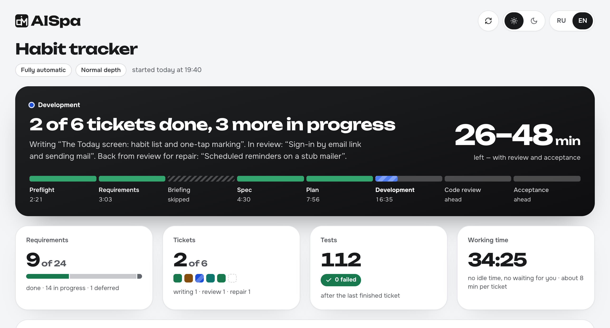
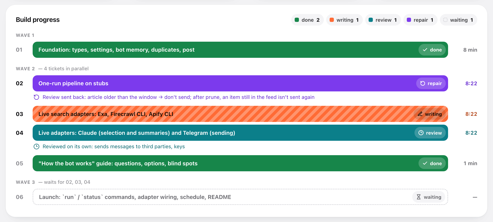
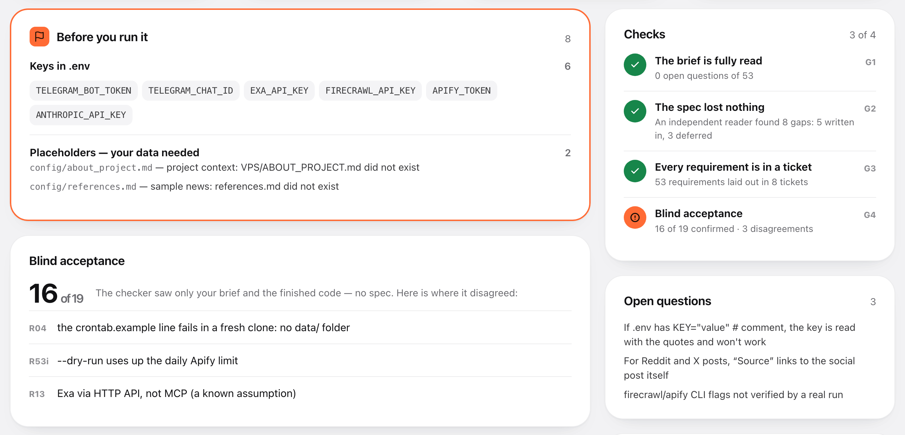
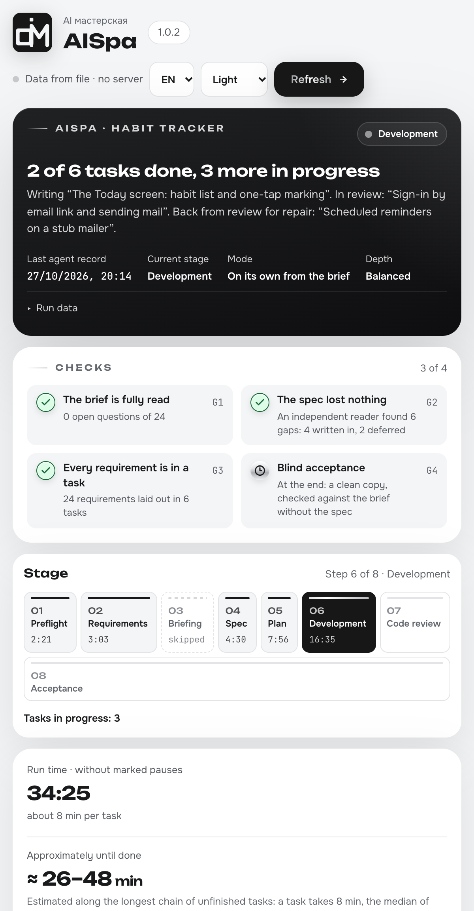
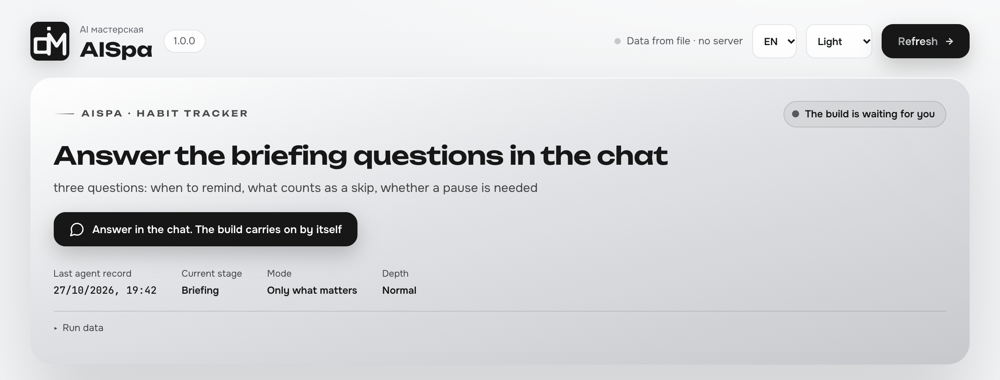
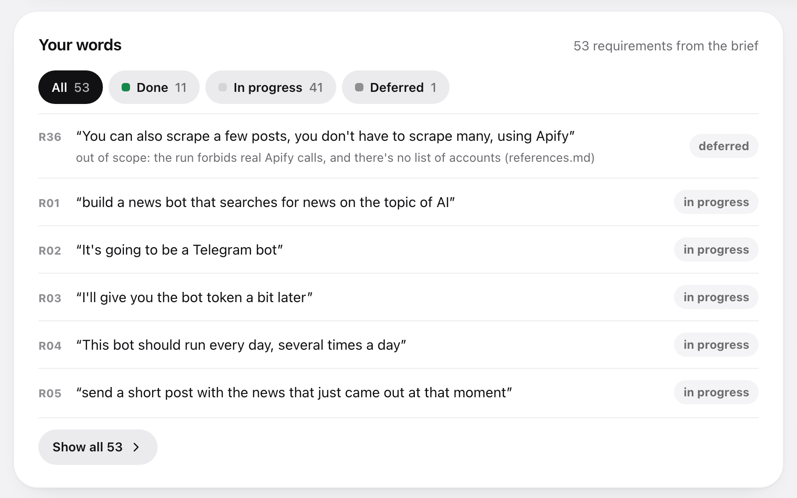

<p align="center">
  <picture>
    <source media="(prefers-color-scheme: dark)" srcset="assets/aispa-logo-dark.png">
    <source media="(prefers-color-scheme: light)" srcset="assets/aispa-logo-light.png">
    
  </picture>
</p>

<p align="center">
  <a href="https://skills.sh/alexfisenkov/aispa"></a>
</p>

<p align="center"><strong>Describe what you want built — get a finished project.</strong></p>

<p align="center"><b>English</b> · <a href="README.ru.md">Русский</a></p>

AISpa is a development framework packaged as a skill. It takes your idea, asks questions exactly where the idea forks, and then does the rest on its own: writes the spec, thinks through what you didn't, splits the work into tasks and builds the whole project. You don't have to read the spec, size the tasks or understand the code.

It works on its own: nothing else to install.

<p align="center">
  <a href="assets/aispa-dashboard.png"></a>
  <a href="assets/aispa-dashboard.png"></a>
  <a href="assets/aispa-dashboard.png"></a>
</p>

<p align="center"><sub>Header · build progress · the report of a finished build — <a href="assets/aispa-dashboard.png">open the full dashboard</a></sub></p>

**And you can always see what's going on.** At the start of a build the agent opens the dashboard itself — a single HTML file you never have to find or launch. The header colour tells you the state at a glance: blue — the build is running, orange — it's waiting for your answer, green — done. Below: what is happening right now, how much is left, every task as a coloured bar and every one of your requirements in your own words. Timers tick live, the page refreshes itself, no internet needed.

---

## Installation

### If you'd rather not open a terminal

Open your AI agent — Claude Code, Cursor, Codex — and paste this:

```
Install the AISpa skill for me. Run in the terminal:

npx skills add alexfisenkov/aispa --skill aispa -g -y -a <put yourself here: claude-code, cursor, codex>

If npx is not found, give me a link to download Node.js and wait.
Don't install anything else.
When you're done, tell me in one line that it's ready and that the session needs a restart.
```

The agent does the rest. Then restart it — skills are loaded at startup.

This command is for the **first** install. Updating later is [a different command](#updating-and-removing).

### From the terminal

Copy this line:

```bash
npx skills add alexfisenkov/aispa
```

The installer asks which skills to install and for which agents — just confirm.

<details>
<summary>One-line install, no questions</summary>

```bash
npx skills add alexfisenkov/aispa --skill aispa -a claude-code -g -y
```

| Flag | What it does |
|------|--------------|
| `--skill aispa` | Installs only AISpa |
| `-a claude-code` | Installs for Claude Code |
| `-g` | Globally — the skill is available in every project |
| `-y` | Don't ask questions |

Without `-g` the skill is installed into the current project folder only.

</details>

**Requires:** [Node.js](https://nodejs.org) (for `npx`) and any supported AI agent — Claude Code, Cursor, Codex and [70+ others](https://github.com/vercel-labs/skills#supported-agents). Nothing else.

---

## How to use it

Open your agent in the folder of the future project and type:

```
/aispa I want a Telegram bot that takes repair requests for appliances
and puts them into a Google Sheet
```

AISpa starts **only on this command**. It never starts by itself, even if you write "just build it": it creates a repository, writes code and commits, and that should only begin when you say so.

**If the task is big, put it in a file.** A detailed description doesn't fit in one chat line, and you shouldn't cut it short: the more you tell, the less has to be guessed for you. Create a file next to the project — any name, `brief.md`, `idea.txt`, `task.md` — and describe everything in free form: what the project is, who it's for, what it must do, what you dislike about competitors, any budget and deadline constraints. Then just point to it:

```
/aispa brief.md
```

```
/aispa max docs/idea.md but no card payments
```

The agent reads the file and takes its contents as the task; your file stays untouched, and a copy goes into `.aispa-work/` — that copy is what the result is checked against at the end. Words written after the path are added to the same task.

After that, all you do is answer a few questions at the very beginning.

If you didn't name a mode, the agent first asks one thing — how to work — and waits for your answer:

```
How do we work? Answer with a number or a word:
1. On my own from the brief (сам по брифу) — I ask nothing about the brief; decisions made for you are listed in the report.
2. Only what matters (только важное) — I ask only what the brief leaves undecided and what changes the result.
3. Interview (интервью) — I go through the whole brief in detail, topic by topic. There will be many questions — several dozen on an ordinary project — but I build exactly what you have in mind. Each comes with my own answer: usually "ok" is enough, and where the choice matters I'll ask you to name a letter. If you like, I'll ask one at a time. Then I build it myself.
4. Manual (ручной) — like interview, plus you approve the spec and the task list.
```

Named the mode in the command — no such question. An unclear answer means "only what matters".

Next, if you didn't name a depth, comes a second question — how much to work out beyond what you wrote (details in [Depth](#depth)). The agent asks it in the language of your task:

```
How much to work out beyond the brief? Answer with a number or a word:
1. Fast (быстро) — cheaper and quicker: only what you said and what it can't work without. No ideas of my own.
2. Balanced (сбалансированно) — sensibly: I close the gaps that would clearly spoil the result and may suggest something of my own, in moderation. Middle price and time.
3. Maximum (максимум) — slower and more expensive: every requirement goes through the full checklist (first run, empty screen, errors, dropped connection, who may do what, what happens next) and I separately look for where the idea might fail.
Checks and acceptance run whichever you pick — only the amount of elaboration changes.
```

The question is asked in every mode, `auto` included; naming the depth in the command skips it. An unclear answer means Balanced.

Then the agent tells you which mode it's in and how to switch, and **it opens the dashboard itself** — no commands to remember, no files to look for:

```
Mode: only what matters · depth: balanced — I'll only ask what the brief leaves undecided, then build the rest myself.
Dashboard is open and refreshes itself: http://localhost:52814/dashboard.html
Project memory — AGENTS.md (+ CLAUDE.md pointing to it).

You can switch at any time, just say:
• "on my own from the brief" — I ask nothing about the brief
• "interview me" — I go through the whole brief in detail, then build it myself
• "manual" / "approve every step" — the same, plus you approve the spec and the task list
• "fast" / "maximum" — less or more elaboration beyond what you said
• "one at a time" — I ask questions one by one instead of several at once
```

Questions come in **rounds**: up to four at once, on one topic, numbered, each with the answer the agent would pick itself. Agree with all — reply "ok"; disagree with one — "2 — a spreadsheet, the rest ok". Where the answer decides what you get, the question is marked ⚑ with options а/б/в — that letter you pick yourself; "ok" does not stand in for it.

When there are more questions than one round, AISpa first asks how you prefer them: in batches of 3–4 or one at a time. You can also say **"one at a time"** (in the command, in the answer to the first question, or at any moment): the agent asks one question per message, still with its own answer. "In rounds" switches back.

In interview and manual mode there are many questions — several dozen on an ordinary project: the agent walks the brief requirement by requirement until every fork is closed. Before the first question it shows the topics and roughly how many questions there are, and every round says how many are left. Had enough — say **"decide the rest yourself"**: it settles the rest and lists those decisions in the report.

---

## Four modes

After `/aispa` you can add how closely you want to be involved. Add nothing — the agent asks it as its first question (the four options above).

| Mode | How to turn it on | What you're asked |
|---|---|---|
| **On my own from the brief** (`auto`) | `/aispa auto ...` or "don't ask me anything" | Nothing about the brief (only the one start question about depth, if you didn't name it in the command). At the end — a list of decisions made for you |
| **Only what matters** (`important`) | `/aispa important ...`; also what an unclear answer to the first question means | Only what the brief leaves undecided and what changes the result: usually one or two rounds of questions. If everything is clear — none |
| **Interview** | `/aispa interview ...`, "interview me", "ask me everything" | The whole brief in detail, topic by topic: for every requirement — what its words mean, what an empty screen shows, what happens on an error, who may do what, what comes after. Plus where the idea might not work. Usually several dozen questions, one at a time if you like. Then it builds on its own |
| **Manual** | `/aispa manual ...` or "approve every step" | Same as interview, then your "ok" on the spec and on the task list |

```
/aispa auto a landing page for pizza delivery

/aispa A Telegram bot for booking manicure appointments

/aispa manual CRM for a car repair shop, I want to approve the spec myself
```

The words `auto`, `important`, `interview`, `manual` are written without dashes. The old words still work: `full` ("fully automatic") means `auto`, `semi` ("semi-auto") means `important`. You can change the mode along the way — "switch to manual" — it applies from the next stage.

**What no mode changes:** the agent asks before anything irreversible — publishing, payments, messaging people, deleting data. And no mode turns off the check against your original task.

---

## Depth

A separate dial, independent of the mode. The mode decides **how much you're asked**; depth decides **how much is thought through for you beyond the brief**. Name it in the command, or the agent asks it as a second question right after the mode (three options, each with its price in words).

| Depth | How to turn it on | What the agent does | Cost |
|---|---|---|---|
| **Fast** | `/aispa fast ...` or "fast, only what I wrote" | Only what you wrote, plus whatever the requirement cannot work without (wrong input, failures). No features of its own — not even good ones | Cheaper and faster |
| **Balanced** *(default)* | `/aispa balanced ...`; also what an unclear answer means | Works through the gaps that would clearly spoil the result. It may add things of its own, but each tied to one of your requirements | Middle |
| **Maximum** | `/aispa max ...` or "think it through", "go deep" | Every requirement goes through the full checklist: first run, empty screen, bad input, failure, dropped connection, growth, permissions, consequences. Plus a separate pass for where the idea might fail | Slower and more expensive |

The old words still work: `strict` means Fast, `normal` means Balanced, `deep` means Maximum.

```
/aispa fast a feedback form, exactly as I described

/aispa max an online ceramics store

/aispa auto max a marketplace for craftspeople
```

Word order doesn't matter, both settings are optional. Like the mode, depth can be changed along the way: "less improvising" or "think it through more".

**Depth changes only how much is worked out, not the checks.** The manifest gates, the review of every task and the blind acceptance run at every level — Fast does not skip them.

**One rule holds at every depth:** anything the agent adds on its own is tied to one of your requirements and listed separately in the final report. A feature not tied to anything gets cut.

---

## Reference — what it should look like

If there are sites, apps or texts the result should resemble, say so when the agent asks during the briefing. They go into `reference.md` and are handed to the agents that build what you will see: the interface is made "like that one" from the start, not adjusted afterwards. The agent never passes off its own taste as yours — a reference only ever comes from you.

---

## Two things AISpa does differently

### Your task doesn't get lost along the way

The usual problem with building "from a description": you dictate a big brief, then come questions, a spec, tasks, code — and at the end half of what you asked for just isn't there. Not because anyone refused, but because at some step it stopped being mentioned.

AISpa's first move is to split your text into **numbered requirements** and write them down word for word. From then on each requirement has a status, and every stage has a check:

- after the spec — no requirement is left without a section;
- after the split — every requirement has a task, **and every task has a requirement** (this catches work nobody ordered);
- at the end — **blind acceptance**: a separate agent gets only your original text and the finished project, not the spec. It checks the result against your words, not against a retelling. If it and the tracker disagree, you'll see that in the report.

**Only you can drop a requirement.** The agent may suggest deferring one — it may not strike it out. Silence doesn't count as cancelling.

### What you didn't think of is thought through for you

In a brief you describe how things work when everything goes well. You don't describe what to show on an empty screen, what happens when the connection drops, what happens if someone presses "send" twice, or what a person sees on the very first run. That's not an oversight — it's just not the level at which people describe a task.

Thinking this through is a large part of AISpa's value, and you set how much of it happens with [depth](#depth). At Balanced the agent closes the gaps that would clearly spoil the result; at Maximum it runs every requirement through the full checklist. Some things it decides itself (an error message, sensible limits); where the decision really is yours, it turns it into a question.

At Maximum depth one requirement from the brief unfolds into several worked-out scenarios — as many as it really has sides. That's the difference between "works in the demo" and "works".

---

## Progress is always visible



`.aispa-work/dashboard.html` **opens by itself** at the very start of the build — nothing to find or launch. If the agent can show a page inside its own window (for example, the side pane in the Claude app), the dashboard opens there and everything stays in one window; otherwise in your browser. In a narrow pane next to the chat it gets denser: the same blocks, without the giant numbers. Works offline. While the build runs, the page pulls fresh numbers every ten seconds — without reloading, so your scroll position and selected text stay put; the ⟳ arrow at the top refreshes at once. Next to it are the theme (light / dark) and language (RU / EN) switches; until you touch the theme, the dashboard follows your system.

**The header — what's happening, in one sentence.** Blue: the build is running — "2 of 6 tickets done, 3 more in progress", which tickets are being written, which are in review, and how long until done including review and acceptance. Orange: **the build is waiting for you** — briefing questions, your "ok" on the spec in manual mode, a decision before an irreversible step; the browser tab says "● Waiting for you", and the build clock is stopped meanwhile. Green: done — what you now have and what you need to do to run it for real. Under the sentence — eight stages from preflight to acceptance: passed, current, skipped.

**Tasks by wave — every state has its own colour.** Each task is a card with a coloured stripe on the left: green — done, blue — being written, teal — in review, amber — back from review for repair, red — failed, grey — waiting its turn. Under the title — which requirements it covers, on the right — its state and time, below — the steps "writing → review → repair → done". Why a task is in review or repair is written right there; open "Requirements and task details" to see the requirements in your words, the zone, dependencies, tests and the commit. Each wave shows how many tasks are done and a progress bar: you can see what runs in parallel and what the next wave is waiting for.

**Requirements.** Every requirement from the brief — as your quote, with what became of it: done, in progress, needs your data, deferred, dropped by you. Deferred items and placeholders show the reason. This is AISpa's main promise — nothing disappears quietly — and here you can check it with your own eyes.

<p align="center">
  
  
</p>


| Block | What it shows |
|---|---|
| **Requirements** | How many of your requirements are closed. Tasks can be 100 % done while the brief is at 70 % |
| **Checks G1–G4** | The brief is fully read · the spec lost nothing · every requirement is in a task · blind acceptance. A check gets its tick when it passes |
| **Feed** | The latest events in words: task done, sent to review, back for repair, the plan adds up. The best answer to "is it alive?" |
| **Needed from you** | Keys for `.env`, placeholders standing in for your data, decisions made for you |
| **Tests and time** | How many tests are green; working time without idle time and without waiting for your answer |
| **In the report** | Blind acceptance and its disagreements, open questions, review notes with their place in the code |

Even when the project is small and built as a single task, the dashboard is filled the same way: stages, requirements, tests, commit and placeholders. If the session drops, type `/aispa` with no words — the agent restores the state from files and picks up where it left off.

---

## The project remembers itself

The usual trouble with the second session: the agent opens a finished project and spends half an hour figuring out what was built here — on your money. AISpa fixes that with a project description file at the root — `AGENTS.md`.

The file appears **right away**, before the first line of code: the name, the run commands. After that only what was actually learned along the way goes in — the real check command, pitfalls already stepped on, a new environment variable. At the very end a separate agent reads the **finished code** (not the spec — otherwise the description would talk about plans) and writes pointers: how to run it, where things live, where it hurts. For a big project the architecture goes into `docs/architecture.md`, and decisions with their reasons into `docs/adr/`.

| | |
|---|---|
| Which file | `AGENTS.md` — read by Claude Code, Codex, Cursor and other agents. Next to it goes a `CLAUDE.md` with a single line `@AGENTS.md`: without it Claude Code skips `AGENTS.md` if there's another `CLAUDE.md` somewhere up the folder tree |
| You already have your own `CLAUDE.md` or `AGENTS.md` | AISpa **doesn't touch it**. At the end it suggests what to add — new commands, variables, pitfalls — and asks whether to apply it. In `auto` mode the suggestion just stays as a file |
| Size | Proportional to the project, and short: every line of this file is read in every future session |
| Your text | Everything you wrote is untouchable. AISpa writes only inside its own markers |

---

## How it works

The main principle: **the order is the product**. Code is written in the second-to-last phase; everything before it is finding out what exactly to build, everything after is proving that's what got built.

| Phase | What happens |
|---|---|
| **Preflight** | Project folder setup, `.gitignore`, instruments — the dashboard opens right away |
| **Requirements** | Your text → numbered requirements, word for word |
| **Briefing** | Questions in rounds (or one at a time, if you ask), only on real forks; first come the ones the project can't be built without: payments, hosting, access. In interview mode — the whole brief in detail, topic by topic |
| **Spec** | Requirements unfold into worked-out scenarios |
| **Plan** | The spec is cut into tasks — or not, if the job is small — and laid out in waves: what can be built at the same time, and what only in order |
| **Development** | One task = one separate agent with a clean memory, one commit; independent tasks run in parallel |
| **Code review** | At the end, always — the whole build: match with the brief and the spec, code quality, security. Earlier and on its own — only the first task the rest build on, and tasks about sign-in, keys, money and deleting data; that check runs alongside and never holds the build |
| **Acceptance** | A separate agent installs the project from scratch in a clean copy, runs it and checks the result against your original task; the project description for the future; the report |

### On splitting into tasks

Every task is a separate agent that has to get into the project from scratch: read the contracts, study the code, figure out the stack. That's expensive. So AISpa splits by the volume of code, not by "the smaller, the safer": one agent writes about 3,000 lines, tests included.

| Volume | How many tasks |
|---|---|
| Up to ~3K lines — a landing page, a form, a script, a list of edits to an existing project | **one.** One agent builds it all in one pass, like a plain dialogue |
| ~3–6K | 2 |
| ~6–18K | 3–6, one per ~3K lines |
| ~18–36K | 7–12 |

More than 12 is not allowed: the work is split into two runs. Fine-grained splitting doesn't buy reliability, it buys spend.

The other end has a limit too. Every step of an agent re-reads its whole context from the cache, so a task gets more expensive per step the longer it runs. About 3,000 lines is roughly 300–400K tokens of context: past that, a fresh agent is cheaper than a long one.

### On development

| What AISpa does | Why |
|---|---|
| Each task is done by a separate agent | It doesn't get confused by accumulated context and doesn't break what worked |
| Passes the contracts of earlier tasks to the next agent | Otherwise task six reinvents what task three built |
| Independent tasks run in parallel, several agents at once | Waiting in line for things that don't depend on each other is hours wasted |
| One commit per task | Your rollback points |
| Tasks sharing files run one after another | Otherwise two agents overwrite each other's work |
| A full check after every task — tests, types, linter | A regression costs a minute, not an evening |
| Routine tasks go to a cheaper model, the foundation and risky ones to a strong one | You pay for the strong model where it makes a difference |
| Review at the end; on its own only the foundation and a narrow list of risks — in parallel, without stopping the build, and at most one re-check | Review used to eat up to half the spend, and a check after every task held it for 15–40 minutes; the defects worth catching earlier live in the foundation and in sign-in, keys, money and deletion code |
| Fixes after review are made by the same agent that wrote the code | It remembers why the code is the way it is; someone else fixes the symptom and breaks the cause |
| The main conversation writes no code at all — it only hands out work and checks it | Its context is one for the whole run and never refreshes: every diff read on task two gets in the way on task eight |
| A failed task — a retry, then an attempt another way | If that fails too, the agent stops and explains in plain words |
| A plan that diverged from the code is corrected out loud | If it turns out along the way that the plan doesn't work, the agent fixes the plan and tells you in one line — instead of quietly building something else |

---

## When to use it, and when not

**A good fit if:**

- you describe what you need and expect a finished result;
- you're not a programmer and won't read specs and code;
- "just build it", "build it end to end", "don't ask unnecessary questions";
- you want to approve the spec and the task list but not deal with the process — that's manual mode.

**Not a fit if:**

| Situation | What to do instead |
|---|---|
| You want to write code together, line by line | Work with the agent directly |
| The task is an edit in one file | Just ask for it |
| The idea is bigger than one project and the end goal is unclear | Settle on the goal first |

---

## Keys, passwords and access

AISpa **never asks for keys, tokens or passwords** — only which service you want to use and whether you have an account there.

- the question will be "do we take payments via Stripe or PayPal?", not "send me the key";
- the code gets a variable name — `STRIPE_SECRET_KEY`, and you put the value into `.env` yourself;
- `.env` goes into `.gitignore` right away;
- the report lists the variables still to fill in, by name, without values.

If you do send a key in the chat, it **won't end up in any file**: before anything is written, all your text goes through a filter that recognises Stripe, GitHub, AWS, Google and Slack keys, Telegram tokens, JWTs and connection strings. The file gets `[REDACTED:STRIPE_SECRET_KEY]` instead of the value, and you get a warning — a key that has been in a chat should be revoked and reissued.

---

## What AISpa never does

- writes code before there is a spec;
- strikes out your requirements — only you can;
- makes up facts about you: prices, texts and addresses stay visible placeholders, not plausible lies;
- asks you to check tasks, their size or the code;
- runs two tasks in one agent's memory;
- leaves payments, access and hosting for the finish;
- asks for or stores your keys and passwords;
- installs or downloads anything without your knowledge.

---

## Updating and removing

**Only `update` updates.** Don't reinstall the skill with the command from "Installation" — that one is for the first install; updating has its own command:

```bash
npx skills update aispa -g
```

The `-g` flag is for a global install. For a project install, run the command without the flag in that project's folder.

If you'd rather not open a terminal, paste this to your agent:

```
Update the AISpa skill to the latest version. Run in the terminal:

npx skills update aispa -g

If it says everything is up to date but the version is still old, reinstall:
npx skills remove aispa -g -y && npx skills add alexfisenkov/aispa --skill aispa -g -y -a <put yourself here: claude-code, cursor, codex>

When you're done, tell me in one line what was updated and remind me to restart the session.
```

See what's installed, and remove:

```bash
npx skills list
```

```bash
npx skills remove aispa -g
```

**If the skill behaves like an old version.** `update` compares the source version, not the files on disk: if the local copy was edited or got corrupted, it says "everything is up to date" and does nothing. The fix is a reinstall:

```bash
npx skills remove aispa -g -y && npx skills add alexfisenkov/aispa --skill aispa -g -y -a claude-code
```

For the agent to see the new version, **restart the session** — skills are loaded at startup.

### How to know a new version is out

At the start of every build AISpa compares its version with this repository and, if a new one is out, tells you in one line, with the command to update. What changed is in [CHANGELOG.md](CHANGELOG.md). The skill never updates in the middle of a build.

If AISpa was installed not by `npx skills` but from a GitHub Release (every 0.x version was), it updates itself: at the start of a build it says "a new version is out", and after the report, when you say "обнови AISpa" (update AISpa), it shows what will change and installs the new version only after your "install". It can be rolled back the same way.

The check is a couple of short requests to GitHub at the start and at the end of a build, sending no data at all; without internet it stays silent. To turn it off: the environment variable `AISPA_NO_UPDATE_CHECK=1`.

### If you have AISpa 0.x

Nothing to do. The next time you run `/aispa`, the old version offers the update itself — choose "Установить обновление" (install the update). The agent moves to the new version in the same session and starts the build you asked for; later updates arrive the same way. The previous version stays beside it in a hidden `.aispa-backup-…/package` folder — together with anything you had edited in the skill by hand; the agent names that folder in one line and rolls the update back if you ask, in a later session too.

An unfinished build of the old version is not lost: the old version kept its own copy inside the build (`.aispa/runs/…/runtime/`), and on "continue" the agent finishes the build with it. If you come with a new task instead, AISpa asks once: finish the earlier build or start a new one. Finished 0.x builds simply stay in the history. The new version never touches `.aispa/`.

If the old version refused to update (for example, the skill folder is inside a git repository) or does not offer an update at all, install the new one with one command (Node.js 22 or newer):

```bash
npx skills add alexfisenkov/aispa --skill aispa -g -y -a claude-code codex
```

It replaces the folder `~/.claude/skills/aispa` whole: if you edited files there by hand, copy them first. After installing, remove the old copies, or the agent sees AISpa twice:

- `~/.codex/skills/aispa` — Codex reads it as well as the new `~/.agents/skills/aispa`;
- a 0.x copy committed into a project (`.claude/skills/aispa` or `.agents/skills/aispa` in the project folder) — remove it from the project in a commit of its own, if nobody needs it any more.

AISpa reminds you at the start of a build with the line "рядом лежит ещё одна AISpa" (another AISpa lies beside this one) and removes such a copy only on your word.

---

## What's in the repository

```
skills/aispa/
├── SKILL.md                    ← orchestrator: phase order, gates, rules that are never broken
├── phases/                    ← phase rules, read one at a time, when the phase begins
│   ├── 0-modes.md              modes and depth, the opening message
│   ├── 0-preflight.md          repository setup
│   ├── 0-resume.md             resuming an interrupted build
│   ├── 0-instruments.md        dashboard: launch, and one command per event
│   ├── 0-memory.md             choosing the project memory file
│   ├── 1-manifest.md           brief → requirements, secrets filter
│   ├── 2-briefing.md           questions in rounds or one at a time, the interview question map, reference
│   ├── 2-adversarial.md        where the idea might fail — in interview mode and at Maximum depth
│   ├── 3-spec.md               the spec and how deep to work it out
│   ├── 4-plan.md               splitting into tasks by volume, waves, who gets review and which model
│   ├── 5-subagents.md          executor agents and the contracts between them
│   ├── 5-repair.md             repair and failure — only when a task came back not clean
│   ├── 6-review.md             targeted review and the review of the whole build
│   ├── 8-final.md              blind acceptance and the report
│   ├── 9-memory.md             the project description and decisions
│   ├── rationalizations.md     excuses and red flags — a check, not an instruction
│   └── dashboard-template.html the ready-made dashboard with the logo built in
├── prompts/                   ← material for subagents, not for the orchestrator
│   ├── executor.md             how to write code and tests, what to return
│   └── review.md               what the reviewer judges by: three axes and security
└── tools/
    ├── ap.py                   build bookkeeping: state, dashboard, server — one command per event
    ├── aispa.py                the updater of copies installed from a GitHub Release (and the bridge from 0.x)
    └── aispa_core/             its code: release checks, checksums, replace with undo

tools/measure-run.py             ← measuring a real run from Claude Code logs
tools/собрать-выпуск.py          ← the release files for GitHub: aispa.zip, aispa-update.json, install.py
tools/install.py                 ← first install from a Release (for the old latest/download/install.py link)
CHANGELOG.md                     ← what's new, by version
```

The agent reads the `phases/` files one at a time, only when the matching phase begins — so its memory always holds exactly what's needed right now. Everything needed only in rare cases — repair, resuming, stress-testing the idea — lives in separate files and isn't opened until that case comes up.

It's all plain markdown. You can open it and read it: [skills/aispa/SKILL.md](skills/aispa/SKILL.md).

---

## How to change it yourself

AISpa can be changed point by point. Every file is plain text: the rules of each phase live in `skills/aispa/phases/`, the prompts for subagents in `skills/aispa/prompts/`, the orchestrator in `skills/aispa/SKILL.md`, the instruments in `skills/aispa/tools/ap.py`, the dashboard page in `skills/aispa/phases/dashboard-template.html`. Change one rule or one file, run `python3 -B -m unittest discover -s tests`, raise the version (where — below), commit and push to `main`, then update the install with `npx skills update aispa -g`. Without a new version `update` answers "already up to date": it compares versions, not files.

### How to release a new version

`npx skills` installs get a new version from `main` right after the push. Copies installed from a GitHub Release — all former 0.x — see it only in a **Release carrying three files**. So every new version is five steps:

1. **The version in three places, the same:** `metadata.version` in `skills/aispa/SKILL.md`, `VERSION` in `skills/aispa/tools/aispa_core/__init__.py`, and a new `## X.Y.Z` line at the top of `CHANGELOG.md`. The tests check that all three match.
2. **Tests and commit:** `python3 -B -m unittest discover -s tests`, then commit and `git push origin main`. After the push — one check on GitHub on macOS, Linux and Windows: `gh workflow run ci.yml --ref main`, wait for green with `gh run watch`.
3. **Release files:** `python3 tools/собрать-выпуск.py`. It takes the files of the last commit (not of the working folder), puts three files into `dist/` — `aispa.zip`, `aispa-update.json`, `install.py` — and checks them the same way the updater will. If it complains, do not release until it is fixed. Build **after** the last commit: its hash goes into the manifest and must equal the commit of the tag.
4. **A tag on that same commit:** `git tag vX.Y.Z && git push origin vX.Y.Z`.
5. **The Release with the files:**

   ```bash
   gh release create vX.Y.Z dist/aispa.zip dist/aispa-update.json dist/install.py \
     --title "AISpa X.Y.Z" --notes "what's new — CHANGELOG.md" --latest
   ```

Four rules; break one and updates stop for everyone who installed from a Release:

- **Every Release carries these three files**, a pre-release included. The updater takes the newest Release and checks the files only there: a Release without them stops the update for everyone until it is fixed.
- **A regular version is not a pre-release and is marked Latest** (`--latest`). Trial versions (`1.1.0-beta.1`) are seen only by those who have a trial version installed.
- **A published Release is never re-uploaded.** A mistake means a new version with a new number.
- **Never delete or rename `skills/aispa/tools/aispa.py` and `skills/aispa/tools/aispa_core/`:** Release copies update through them, and the 0.x installers load them from the tag's commit. The tests check this.

**Once, together with the `v1.0.1` Release:** the `v1.0.0` Release was published without files. It does not stop 0.x from updating (the newer one is taken), and from 1.0.1 on `install.py` skips Releases without files, so the `releases/latest/download/install.py` link works as soon as `v1.0.1` is Latest. The old `install.py` of `v0.4.0`, if someone kept a copy, stumbles on `v1.0.0` — so mark it as a pre-release:

```bash
gh release edit v1.0.0 --prerelease --latest=false
curl -sIL https://github.com/alexfisenkov/aispa/releases/latest/download/install.py | grep -i '^location' | tail -1   # must point at the newest Release
```

## License

[MIT](LICENSE) © Alexander Fisenkov, © Nick Vels (Autopilot 2.2.0, the base) — you may use, modify and distribute it, including in commercial projects.
