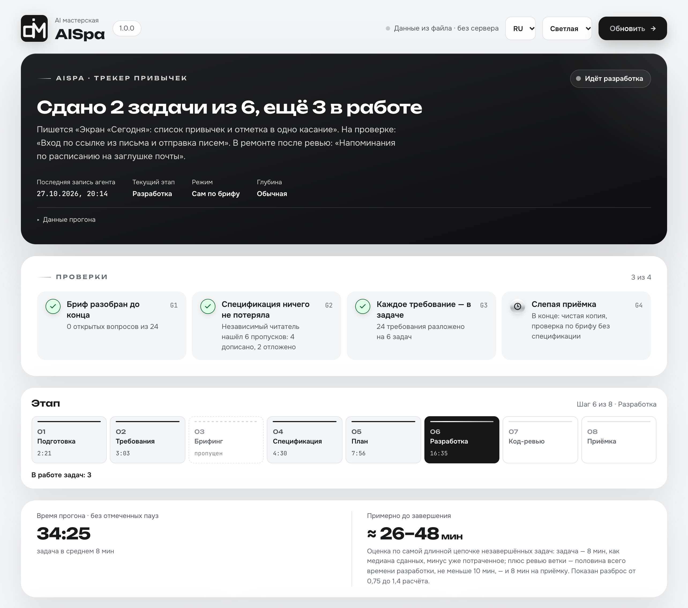
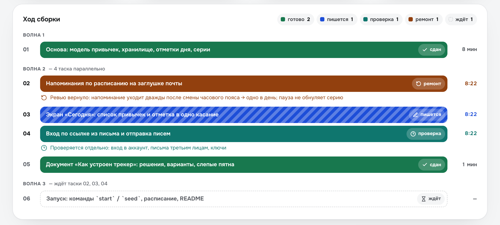
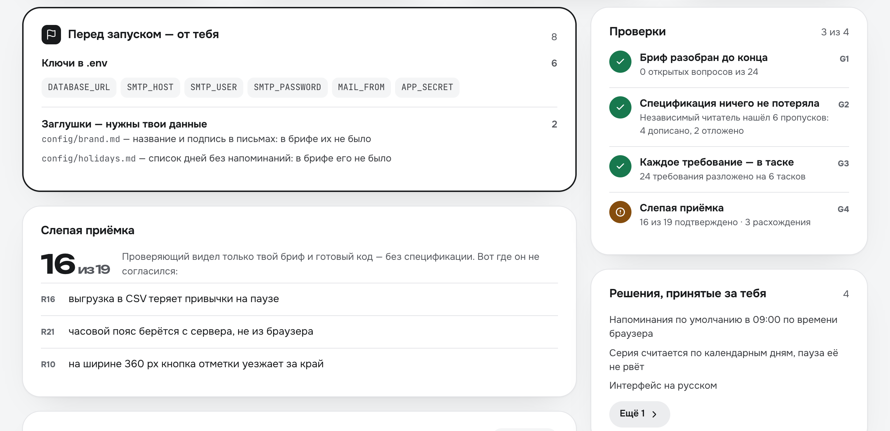
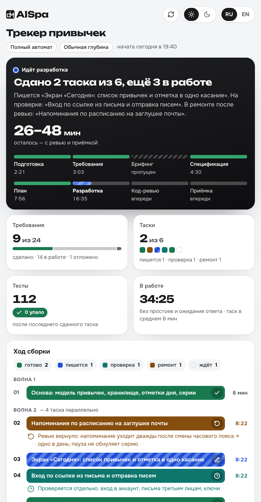
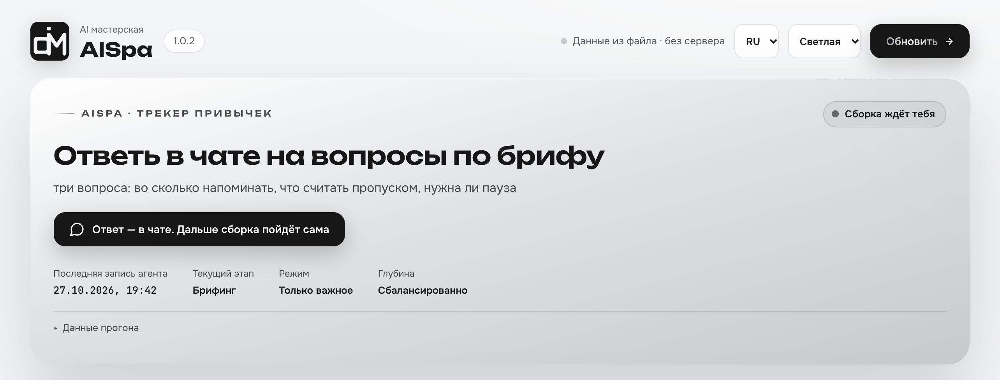
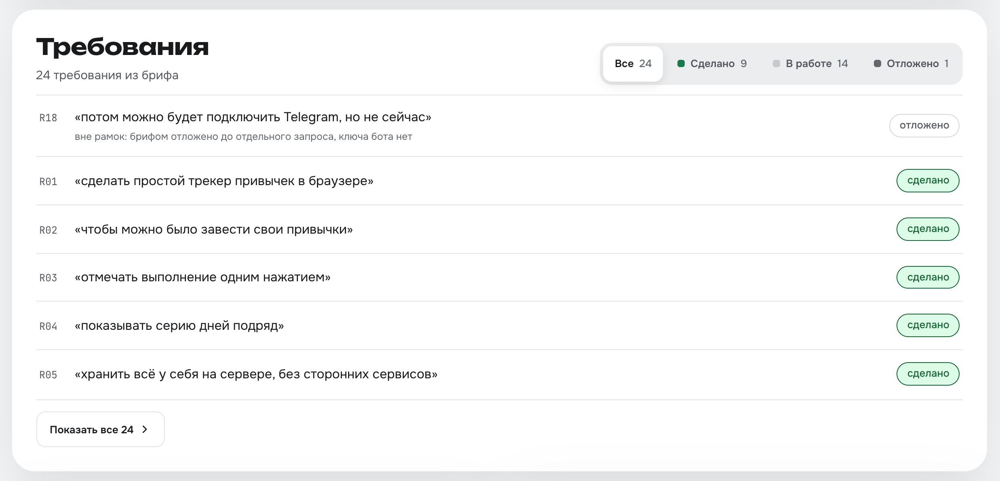

<p align="center">
  <picture>
    <source media="(prefers-color-scheme: dark)" srcset="assets/aispa-logo-dark.png">
    <source media="(prefers-color-scheme: light)" srcset="assets/aispa-logo-light.png">
    
  </picture>
</p>

<p align="center">
  <a href="https://skills.sh/alexfisenkov/aispa"></a>
</p>

<p align="center"><strong>Расскажи словами, что нужно построить — получи готовый проект.</strong></p>

<p align="center"><a href="README.md">English</a> · <b>Русский</b></p>

AISpa — фреймворк разработки, skill, который берёт вашу идею, задаёт вопросы ровно там, где в ней есть развилки, а дальше сам пишет спецификацию, продумывает то, о чём вы не думали, разбивает работу на задачи и собирает проект целиком. Вам не нужно читать спецификацию, оценивать задачи или разбираться в коде.

Работает сам по себе: ставить что-то ещё не нужно.

<p align="center">
  <a href="assets/ru/aispa-dashboard.png"></a>
  <a href="assets/ru/aispa-dashboard.png"></a>
  <a href="assets/ru/aispa-dashboard.png"></a>
</p>

<p align="center"><sub>Шапка · ход сборки · отчёт сданной сборки — <a href="assets/ru/aispa-dashboard.png">открыть дашборд целиком</a></sub></p>

**И вы всё время видите, что происходит.** В начале сборки агент сам открывает дашборд — один HTML-файл, который не надо искать и запускать. Цвет шапки сразу говорит, что происходит: синяя — сборка работает, оранжевая — она ждёт вашего ответа, зелёная — сдано. Ниже — что делается прямо сейчас, сколько ещё осталось, каждая задача с цветной полосой и шагами и каждое ваше требование вашими же словами. Таймеры идут вживую, страница обновляется сама, интернет не нужен.

---

## Установка

### Не хотите открывать терминал

Откройте своего AI-агента — Claude Code, Cursor, Codex — и вставьте ему этот текст:

```
Установи мне навык AISpa. Выполни в терминале:

npx skills add alexfisenkov/aispa --skill aispa -g -y -a <подставь себя: claude-code, cursor, codex>

Если npx не найдётся — дай мне ссылку, где скачать Node.js, и подожди.
Больше ничего не устанавливай.
Когда закончишь — напиши одной строкой, что готово и что надо перезапустить сессию.
```

Агент всё сделает сам. После этого перезапустите его — навыки читаются при старте.

Это команда для **первой** установки. Обновлять потом — [другой командой](#обновление-и-удаление).

### Через терминал

Скопируйте строку:

```bash
npx skills add alexfisenkov/aispa
```

Установщик спросит, какие навыки поставить и для каких агентов — просто подтвердите.

<details>
<summary>Установка одной командой, без вопросов</summary>

```bash
npx skills add alexfisenkov/aispa --skill aispa -a claude-code -g -y
```

| Флаг | Что делает |
|------|------------|
| `--skill aispa` | Ставит только AISpa |
| `-a claude-code` | Ставит для Claude Code |
| `-g` | Глобально — навык доступен во всех проектах |
| `-y` | Не задавать вопросов |

Без `-g` навык встанет только в текущую папку проекта.

</details>

**Требуется:** [Node.js](https://nodejs.org) (для `npx`) и любой поддерживаемый AI-агент — Claude Code, Cursor, Codex и [70+ других](https://github.com/vercel-labs/skills#supported-agents). Больше ничего.

---

## Как пользоваться

Откройте агента в папке будущего проекта и напишите:

```
/aispa Хочу телеграм-бота, который принимает заявки на ремонт техники
и складывает их в Google-таблицу
```

AISpa включается **только этой командой**. Сам он не стартует, даже если вы написали «собери под ключ»: он создаёт репозиторий, пишет код и коммитит, и такое должно начинаться только по вашему слову.

**Если задача большая — напишите её в файл.** В одну строку чата подробное описание не помещается, а мельчить не надо: чем больше вы расскажете, тем меньше придётся додумывать за вас. Создайте рядом с проектом файл — название любое, `brief.md`, `идея.txt`, `задача.md` — и опишите там всё в свободной форме: что за проект, для кого, что должно уметь, что вам не нравится у конкурентов, какие есть ограничения по деньгам и срокам. Потом просто укажите на него:

```
/aispa brief.md
```

```
/aispa max docs/идея.md только без оплаты картой
```

Агент прочитает файл и возьмёт его содержимое как задачу; ваш файл при этом останется нетронутым, а его копия ляжет в `.aispa-work/` — именно с ней в конце сверяется результат. Слова, дописанные рядом с путём, идут в ту же задачу.

Дальше нужно будет только ответить на несколько вопросов в самом начале.

Если режим вы не назвали, агент первым делом спросит одно — как работать, и подождёт ответа:

```
Как работаем? Ответь цифрой или словом:
1. Сам по брифу — по брифу ничего не спрашиваю, решения за тебя перечислю в отчёте.
2. Только важное — спрошу только то, что в брифе не определено и меняет результат.
3. Интервью — разберу бриф вопросами до конца, дальше соберу сам.
4. Ручной — как интервью, плюс согласуешь спецификацию и список задач.
```

Назвали режим в самой команде — этого вопроса не будет. Ответ непонятен — работает «только важное».

Следом, если не назвали глубину, будет второй вопрос — сколько прорабатывать сверх написанного (подробнее — в разделе [«Глубина проработки»](#глубина-проработки)):

```
Сколько прорабатывать сверх брифа? Ответь цифрой или словом:
1. Быстро — дешевле и быстрее: делаю только то, что ты сказал, и без чего это не заработает. Своих идей не добавляю.
2. Сбалансированно — по уму: закрою пробелы, которые явно испортят результат, и могу предложить своё в меру. Средняя цена и время.
3. Максимум — дольше и дороже: каждое требование прогоняю по полному списку (первый запуск, пустой экран, ошибки, обрывы связи, кто что может делать, что будет дальше) и отдельно ищу, где идея может не сработать.
Проверки и приёмка идут при любом выборе — меняется только объём проработки.
```

Ответ непонятен — работает «сбалансированно».

Затем агент скажет, в каком режиме работает и как переключиться, и **сам откроет дашборд** — так что помнить команды и искать файлы не нужно:

```
Режим: только важное · глубина: сбалансированно — спрошу только то, что в брифе не определено, дальше соберу сам.
Дашборд открыл — обновляется сам: http://localhost:52814/dashboard.html
Память проекта — AGENTS.md (+ CLAUDE.md со ссылкой).

Можно переключить в любой момент, просто скажи:
• «сам по брифу» — по брифу не спрашиваю ничего
• «интервью» — разберу бриф вопросами до конца, дальше соберу сам
• «ручной» — то же плюс согласуешь спецификацию и список задач
• «быстро» / «максимум» — меньше или больше проработки сверх сказанного
```

Вопросы приходят **раундами**: несколько сразу, пронумерованные, у каждого — ответ, который агент выбрал бы сам. Согласны со всем — отвечаете «ок», не согласны с одним — «2 — таблица, остальное ок».

---

## Четыре режима

После `/aispa` можно дописать, насколько плотно вы хотите участвовать. Ничего не написали — агент спросит это первым вопросом (четыре варианта выше).

| Режим | Как включить | Что спрашивают у вас |
|---|---|---|
| **Сам по брифу** | `/aispa auto ...` или «сам по брифу», «ничего не спрашивай» | По брифу — ничего (кроме стартового вопроса о глубине, если вы не назвали её в команде). В конце — список решений, принятых за вас |
| **Только важное** | `/aispa important ...` или «только важное»; если ответ на стартовый вопрос непонятен — тоже он | Только то, что в брифе не определено: обычно один-два раунда вопросов. Всё однозначно — ни одного |
| **Интервью** | `/aispa interview ...`, «режим интервью», «погриль меня» | Все развилки до одной, плюс то, где идея может не сработать. Дальше собирает сам |
| **Ручной** | `/aispa manual ...` или «ручной режим» | То же, что в интервью, потом ваше «ок» на спецификацию и на список задач |

```
/aispa auto лендинг для доставки пиццы

/aispa Телеграм-бот для записи на маникюр

/aispa manual CRM для автосервиса, хочу сам утвердить спецификацию
```

Слова `auto`, `important`, `interview`, `manual` пишутся латиницей, без дефисов. Прежние слова тоже понимаются: `full` и «полный автомат» — это «сам по брифу», `semi` и «полуавтомат» — «только важное». Режим можно поменять по ходу — «переключись в ручной», применится со следующего этапа.

**Что не меняется ни в одном режиме:** агент спросит перед необратимым — публикацией, оплатой, рассылкой, удалением данных. И ни один режим не отключает сверку с вашей изначальной задачей.

---

## Глубина проработки

Отдельная ручка, независимая от режима. Режим решает, **сколько у вас спросят**; глубина — **сколько додумают за вас сверх написанного**. Назовите её в команде — или агент спросит сам вторым вопросом, сразу после режима: три варианта, у каждого сказано, сколько это стоит.

| Глубина | Как включить | Что делает агент | Цена |
|---|---|---|---|
| **Быстро** | `/aispa fast ...` или «быстро, только по брифу», «ничего не добавляй» | Только то, что вы написали, и то, без чего оно не заработает (неверный ввод, сбои). Никаких своих фич — даже хороших | Дешевле и быстрее |
| **Сбалансированно** *(по умолчанию)* | `/aispa balanced ...`; так же, если ответ непонятен | Прорабатывает то, где пробел явно испортит результат. Своё добавить может, но с привязкой к вашему требованию | Средняя |
| **Максимум** | `/aispa max ...` или «проработка по максимуму», «продумай за меня» | Каждое требование прогоняется по полному списку: первый запуск, пустой экран, неверный ввод, отказ, обрыв, рост, кто что может делать, что будет дальше. Ещё отдельно ищет, где идея может не сработать | Дольше и дороже |

Прежние слова тоже понимаются: `strict` — это «Быстро», `normal` — «Сбалансированно», `deep` — «Максимум».

```
/aispa fast форма обратной связи, ровно как описал

/aispa max интернет-магазин керамики

/aispa auto max маркетплейс мастеров
```

Порядок слов не важен, оба параметра необязательны. Глубину, как и режим, можно поменять по ходу: «поменьше отсебятины» или «продумай глубже».

**Глубина меняет только объём проработки, а не проверки.** Проверка каждой задачи и приёмка в конце идут при любом выборе — «Быстро» их не пропускает.

**На любой глубине действует одно правило:** всё, что агент добавил от себя, привязано к вашему требованию и попадает в финальный отчёт отдельным списком. Фича, которая ни к чему не привязана, вырезается.

---

## Эталон — на что должно быть похоже

Если у вас есть сайты, приложения или тексты, на которые результат должен быть похож, — скажите об этом, когда агент спросит в брифинге. Они лягут в `reference.md` и уйдут тем агентам, которые строят то, что вы будете видеть: интерфейс сразу делается «как там», а не выравнивается потом. Свой вкус агент за ваш не выдаёт — эталон бывает только ваш.

---

## Две вещи, которые AISpa делает иначе

### Ваша задача не теряется по дороге

Обычная проблема сборки «по описанию»: вы надиктовали большой бриф, дальше пошли вопросы, спецификация, задачи, код — и на выходе половины из того, что вы просили, просто нет. Не потому что отказались, а потому что на каком-то шаге это перестало упоминаться.

AISpa первым делом разбирает ваш текст на **пронумерованные требования** и записывает их дословно в файл. Дальше у каждого требования есть статус, и на каждом этапе стоит проверка:

- после спецификации — ни одно требование не осталось без раздела;
- после разбивки — у каждого требования есть задача, **и у каждой задачи есть требование** (это ловит работу, которую никто не заказывал);
- в конце — **слепая приёмка**: отдельный агент получает только ваш исходный текст и готовый проект, спецификацию ему не дают. Он проверяет результат против ваших слов, а не против пересказа. Если он и трекер расходятся — вы увидите это в отчёте.

**Снять требование может только вы.** Агент вправе предложить отложить — вычеркнуть не вправе. Молчание отменой не считается.

### То, о чём вы не подумали, продумывают за вас

В брифе вы описываете, как всё работает, когда всё хорошо. Вы не описываете, что показать на пустом экране, что будет при обрыве связи, что случится, если нажать «отправить» дважды, и что видит человек в самый первый запуск. Это не упущение — это просто не тот уровень, на котором формулируют задачу.

Продумать это — большая часть ценности AISpa, и объём этой работы вы задаёте [глубиной](#глубина-проработки). На «Сбалансированно» агент закрывает пробелы, которые явно испортят результат; на «Максимум» — прогоняет каждое требование по полному списку. Что-то он решит сам (текст ошибки, разумные лимиты), а что-то, где решение действительно ваше, вынесет в вопросы.

На «Максимум» одно требование из брифа разворачивается в несколько проработанных сценариев — столько, сколько у него реально есть сторон. Это и есть разница между «работает на демо» и «работает».

---

## Прогресс видно всегда



`.aispa-work/dashboard.html` **открывается сам** в самом начале сборки — искать и запускать ничего не нужно. Если агент умеет показывать страницу внутри своего окна (например, панель в приложении Claude), дашборд откроется там, и всё останется в одном окне; иначе — во внешнем браузере. В узкой панели рядом с чатом он становится плотнее: те же блоки, но без гигантских цифр. Работает офлайн. Пока сборка идёт, страница сама подтягивает свежие цифры каждые десять секунд — не перезагружаясь, так что место на странице и выделенный текст не теряются; стрелка ⟳ вверху обновляет сразу. Рядом — переключатели темы (светлая / тёмная) и языка (RU / EN); пока тему не трогали, дашборд следует за системной.

**Шапка — что происходит одной фразой.** Синяя: сборка работает — «Сдано 2 задачи из 6, ещё 3 в работе», какие задачи пишутся, какие на проверке, и сколько осталось до сдачи вместе с ревью и приёмкой. Оранжевая: **сборка ждёт вас** — вопросы брифинга, «ок» на спецификацию в ручном режиме, решение перед необратимым шагом; вкладка браузера тоже говорит «● Ждём ответа», а часы сборки в это время стоят. Зелёная: сдано — что теперь есть и что нужно от вас, чтобы запустить по-настоящему. Под фразой — восемь этапов от подготовки до приёмки: пройденные, текущий, пропущенные.

**Задачи по волнам — у каждого состояния свой цвет.** Каждая задача — карточка с цветной полосой слева: зелёная — сдана, синяя — пишется, бирюзовая — на проверке, янтарная — вернулась с ревью в ремонт, красная — не собралась, серая — ждёт своей очереди. Под названием — какие требования она закрывает, справа — состояние и время, ниже — шаги «пишется → проверка → ремонт → сдана». Почему задача на проверке или в ремонте, написано тут же; раскрыв «Требования и подробности задачи», видно требования вашими словами, зону, зависимости, тесты и коммит. У каждой волны — сколько задач сдано и полоска прогресса: видно, что идёт параллельно и чего ждёт следующая волна.

**Требования.** Каждое требование из брифа — вашей цитатой и с тем, что с ним стало: сделано, в работе, нужны ваши данные, отложено, снято вами. У отложенного и заглушки — причина. Это главное обещание AISpa — ничего не пропадёт тихо, — и здесь его можно проверить глазами.

<p align="center">
  
  
</p>


| Блок | Что показывает |
|---|---|
| **Требования** | Сколько ваших требований закрыто. Задачи бывают готовы на 100 %, а бриф — на 70 % |
| **Проверки G1–G4** | Бриф разобран до конца · спецификация ничего не потеряла · каждое требование в задаче · слепая приёмка. Галочка ставится, когда проверка прошла |
| **Лента** | Последние события словами: задача сдана, ушла на проверку, вернулась в ремонт, план сошёлся. Лучший ответ на «оно живо?» |
| **Понадобится от тебя** | Ключи для `.env`, заглушки на месте ваших данных, решения, принятые за вас |
| **Тесты и время** | Сколько тестов зелёные; рабочее время без простоев и без ожидания вашего ответа |
| **В отчёте** | Слепая приёмка и её расхождения, открытые вопросы, замечания ревью с адресом в коде |

Даже когда проект небольшой и собирается одной задачей, дашборд заполнен так же: этапы, требования, тесты, коммит и заглушки. Если сессия оборвалась — напишите `/aispa` без слов, агент поднимет состояние из файлов и продолжит с того места, где остановился.

---

## Проект помнит себя сам

Обычная беда второй сессии: агент открывает готовый проект и полчаса разбирается, что тут вообще построено, — за ваши же деньги. AISpa закрывает это файлом описания проекта в корне — `AGENTS.md`.

Файл появляется **сразу**, ещё до первой строчки кода: название, команды запуска. Дальше туда попадает только то, что реально выяснилось по ходу — настоящая команда проверки, грабли, на которые уже наступили, новая переменная окружения. А в самом конце отдельный агент читает **готовый код** (не спецификацию — иначе описание рассказывало бы про планы) и пишет указатели: как запустить, где что лежит, где больно. У большого проекта архитектура уходит в `docs/architecture.md`, а решения с причинами — в `docs/adr/`.

| | |
|---|---|
| Какой файл | `AGENTS.md` — его читают Claude Code, Codex, Cursor и другие агенты. Рядом ложится `CLAUDE.md` с одной строкой `@AGENTS.md`: без него Claude Code пропустит `AGENTS.md`, если где-то выше по папкам лежит другой `CLAUDE.md` |
| У вас уже есть свой `CLAUDE.md` или `AGENTS.md` | AISpa его **не трогает**. В конце он предложит, что дописать — новые команды, переменные, грабли, — и спросит, применить ли. В режиме «сам по брифу» предложение просто останется файлом |
| Объём | По размеру проекта и коротко: каждая строка этого файла читается в каждой следующей сессии |
| Ваш текст | Всё, что написали вы, — неприкосновенно. AISpa пишет только внутри своих меток |

---

## Как это работает

Главный принцип: **порядок и есть продукт**. Код пишется в предпоследней фазе, всё до неё — выяснение, что именно строить, всё после — доказательство, что построили именно это.

| Фаза | Что происходит |
|---|---|
| **Подготовка** | Настройка папки проекта, `.gitignore`, приборы — дашборд открывается сразу |
| **Требования** | Ваш текст → пронумерованные требования, дословно |
| **Брифинг** | Вопросы раундами и только по реальным развилкам; первыми — те, без ответа на которые проект не собрать: оплата, хостинг, доступы |
| **Спецификация** | Требования разворачиваются в проработанные сценарии |
| **План** | Спецификация режется на задачи — или не режется, если работа небольшая — и раскладывается на волны: что можно собирать одновременно, а что только по очереди |
| **Разработка** | Одна задача = один отдельный агент с чистой памятью, один коммит; независимые задачи идут параллельно |
| **Код-ревью** | В конце — всегда вся сборка целиком: соответствие брифу и спецификации, качество кода, безопасность. Отдельно и раньше — только первая задача, на которой строятся остальные, и задачи про вход, ключи, деньги и удаление данных; такая проверка идёт параллельно и сборку не держит |
| **Приёмка** | Отдельный агент ставит проект с нуля в чистой копии, запускает и сверяет результат с вашей изначальной задачей; описание проекта на будущее; отчёт |

### Про нарезку на задачи

Каждая задача — это отдельный агент, который заново въезжает в проект: читает контракты, изучает код, разбирается со стеком. Это стоит дорого. Поэтому AISpa режет по объёму кода, а не «чем мельче, тем надёжнее»: один агент пишет около 3 тысяч строк вместе с тестами.

| Объём | Сколько задач |
|---|---|
| До ~3 тысяч строк — лендинг, форма, скрипт, список правок в готовом проекте | **один.** Один агент собирает всё за один заход, как в обычном диалоге |
| ~3–6 тысяч | 2 |
| ~6–18 тысяч | 3–6, по одному на ~3 тысячи строк |
| ~18–36 тысяч | 7–12 |

Больше 12 — запрещено: работа разбивается на два запуска. Мелкая нарезка не покупает надёжность, она покупает расход.

У другого края тоже есть предел. На каждом шаге агент заново читает весь свой контекст из кэша, поэтому чем дольше идёт задача, тем дороже каждый следующий шаг. Около 3 тысяч строк — это примерно 300–400 тысяч токенов контекста: дальше свежий агент дешевле длинного.

### Про разработку

| Что делает AISpa | Зачем |
|---|---|
| Каждую задачу выполняет отдельный агент | Не путается в накопившемся контексте и не ломает то, что работало |
| Передаёт следующему агенту контракты предыдущих | Иначе шестая задача заново изобретёт то, что построила третья |
| Независимые задачи идут параллельно, по нескольку агентов сразу | Ждать по очереди то, что не зависит друг от друга, — это часы на пустом месте |
| Один коммит на задачу | Ваши точки отката |
| Задачи с общими файлами идут по очереди | Иначе два агента перезапишут работу друг друга |
| Полный прогон проверки после каждой задачи — тесты, типы, линтер | Регрессия стоит минуты, а не вечер |
| Рутинные задачи — на модели попроще, фундамент и рискованные — на сильной | Платите за сильную модель там, где она что-то меняет |
| Ревью — в конце, а отдельно только фундамент и узкий список рисков; параллельно, без остановки сборки, и не больше одной перепроверки | Раньше ревью съедало до половины расхода, а проверка после каждой задачи держала его по 15–40 минут; дефекты, ради которых стоит смотреть раньше, живут в фундаменте и в коде входа, ключей, денег и удаления |
| Правки после ревью делает тот же агент, который писал код | Он помнит, почему код такой; чужой чинит симптом и ломает причину |
| Главный диалог не пишет код вообще — только раздаёт и сверяет | Его контекст один на весь запуск и не обновляется: каждый дифф, прочитанный на второй задаче, мешает на восьмой |
| Упавшая задача — повтор, потом попытка другим способом | Если и она не прошла, агент останавливается и объясняет по-человечески |
| План, который разошёлся с кодом, исправляется вслух | Если по ходу выяснилось, что задуманное не работает, агент правит план и говорит вам одной строкой — а не строит молча что-то другое |

---

## Когда использовать, а когда нет

**Подходит, если:**

- вы описываете, что нужно, и ждёте готовый результат;
- вы не программист и не будете читать спецификации и код;
- «собери под ключ», «just build it», «не задавай лишних вопросов»;
- вы хотите утвердить спецификацию и список задач, но не возиться с процессом — это ручной режим.

**Не подходит, если:**

| Ситуация | Что делать вместо |
|---|---|
| Хотите писать код вместе, строчка за строчкой | Работайте с агентом напрямую |
| Задача — правка в одном файле | Просто попросите её сделать |
| Идея больше одного проекта, конечная цель неясна | Сначала определитесь с целью |

---

## Ключи, пароли и доступы

AISpa **никогда не спрашивает ключи, токены и пароли** — только каким сервисом вы хотите пользоваться и есть ли у вас там аккаунт.

- вопрос будет «принимаем оплату через Stripe или ЮKassa?», а не «пришлите ключ»;
- в коде появится имя переменной — `STRIPE_SECRET_KEY`, значение вы вписываете в `.env` сами;
- `.env` сразу в `.gitignore`;
- в отчёте — список переменных, которые осталось заполнить, именами без значений.

Если вы всё-таки пришлёте ключ в чат, он **не попадёт ни в один файл**: перед записью весь ваш текст проходит через фильтр, который распознаёт ключи Stripe, GitHub, AWS, Google, Slack, токены Telegram, JWT и строки подключения. Вместо значения в файл уйдёт `[REDACTED:STRIPE_SECRET_KEY]`, а вам придёт предупреждение — ключ, побывавший в переписке, стоит отозвать и выпустить новый.

---

## Чего AISpa не делает никогда

- не пишет код до того, как появилась спецификация;
- не вычёркивает ваши требования — только вы;
- не выдумывает факты о вас: цены, тексты и адреса останутся видимыми заглушками, а не правдоподобной ложью;
- не просит вас проверять задачи, их размер или код;
- не запускает две задачи в одной памяти агента;
- не оставляет оплату, доступы и хостинг на финиш;
- не просит и не сохраняет ваши ключи и пароли;
- ничего не устанавливает и не скачивает без вашего ведома.

---

## Обновление и удаление

**Обновляет только `update`.** Не переустанавливайте навык командой из раздела «Установка» — она для первой установки; для обновления есть отдельная команда:

```bash
npx skills update aispa -g
```

Флаг `-g` — если навык ставился глобально. Для проектной установки запустите команду без флага в папке того проекта.

Не хотите открывать терминал — вставьте агенту:

```
Обнови навык AISpa до последней версии. Выполни в терминале:

npx skills update aispa -g

Если он ответит, что всё уже обновлено, а версия при этом старая — переустанови:
npx skills remove aispa -g -y && npx skills add alexfisenkov/aispa --skill aispa -g -y -a <подставь себя: claude-code, cursor, codex>

Когда закончишь — напиши одной строкой, что обновилось, и напомни перезапустить сессию.
```

Посмотреть, что установлено, и удалить:

```bash
npx skills list
```

```bash
npx skills remove aispa -g
```

**Если навык ведёт себя как старая версия.** `update` сверяет версию источника, а не файлы на диске: если локальную копию правили или она побилась, он ответит «всё уже обновлено» и ничего не сделает. Лечится переустановкой:

```bash
npx skills remove aispa -g -y && npx skills add alexfisenkov/aispa --skill aispa -g -y -a claude-code
```

Чтобы агент увидел новую версию, **перезапустите сессию** — навыки читаются при старте.

### Как узнать, что вышла новая версия

В начале каждой сборки AISpa сверяет свою версию с этим репозиторием и, если вышла новая, пишет одной строкой, что обновиться и какой командой. Что изменилось — в [CHANGELOG.md](CHANGELOG.md). Посреди сборки навык не обновляется никогда.

Если AISpa ставилась не через `npx skills`, а из выпуска на GitHub (так ставились все версии 0.x), она обновляется сама: в начале сборки пишет «вышла версия …», а после отчёта, когда скажете «обнови AISpa», показывает, что изменится, и ставит новую версию только после вашего «установить». Откатить можно тем же путём.

Проверка — пара коротких запросов к GitHub в начале и в конце сборки, без передачи каких-либо данных; без интернета она молчит. Выключить: переменная окружения `AISPA_NO_UPDATE_CHECK=1`.

### Если у вас стоит AISpa 0.x

Ничего делать не нужно. При следующем запуске `/aispa` старая версия сама предложит обновление — выберите «Установить обновление». Агент перейдёт на новую версию в той же сессии и начнёт сборку по вашему запросу; дальше обновления приходят так же сами. Прежняя версия остаётся рядом в скрытой папке `.aispa-backup-…/package` — там же всё, что вы правили в навыке руками; агент назовёт эту папку одной строкой и откатит обновление, если попросите, хоть в другой сессии.

Незаконченная сборка старой версии не теряется: старая версия сохранила свою копию внутри сборки (`.aispa/runs/…/runtime/`), и на «продолжи» агент доделывает сборку ею. Если вы пришли с новой задачей, AISpa один раз спросит: доделать прежнюю сборку или начать новую. Законченные сборки 0.x просто остаются в истории. Папку `.aispa/` новая версия не трогает.

Если старая версия обновиться отказалась (например, папка навыка лежит в git-репозитории) или вообще не предлагает обновление, поставьте новую одной командой (нужен Node.js 22 или новее):

```bash
npx skills add alexfisenkov/aispa --skill aispa -g -y -a claude-code codex
```

Она заменяет папку `~/.claude/skills/aispa` целиком: если вы правили там файлы руками, сначала скопируйте их. После установки уберите старые копии, иначе агент увидит AISpa дважды:

- `~/.codex/skills/aispa` — Codex читает и её, и новую `~/.agents/skills/aispa`;
- копию 0.x, закоммиченную в проект (`.claude/skills/aispa` или `.agents/skills/aispa` в папке проекта), — её удаляют из проекта отдельным коммитом, если она больше никому не нужна.

AISpa сама напомнит об этом в начале сборки строкой «рядом лежит ещё одна AISpa» — удаляет такие копии только по вашему слову.

---

## Что внутри репозитория

```
skills/aispa/
├── SKILL.md                    ← оркестратор: порядок фаз, гейты, правила, которые не нарушаются
├── phases/                    ← правила фаз, читаются по одной, в момент фазы
│   ├── 0-modes.md              режимы и глубина, стартовое сообщение
│   ├── 0-preflight.md          подготовка репозитория
│   ├── 0-resume.md             продолжение прерванной сборки
│   ├── 0-instruments.md        дашборд: запуск и одна команда на каждое событие
│   ├── 0-memory.md             выбрать файл памяти проекта
│   ├── 1-manifest.md           бриф → требования, фильтр секретов
│   ├── 2-briefing.md           вопросы раундами, эталон
│   ├── 2-adversarial.md        где идея может не сработать — в интервью и на «Максимум»
│   ├── 3-spec.md               спецификация и проработка глубины
│   ├── 4-plan.md               разбивка на задачи по объёму, волны, кому ревью и какая модель
│   ├── 5-subagents.md          агенты-исполнители и контракты между ними
│   ├── 5-repair.md             ремонт и отказ — только когда задача вернулась не чистой
│   ├── 6-review.md             точечное ревью и ревью всей сборки
│   ├── 8-final.md              слепая приёмка и отчёт
│   ├── 9-memory.md             описание проекта и решения
│   ├── rationalizations.md     отговорки и красные флаги — проверка, а не инструкция
│   └── dashboard-template.html готовый дашборд с вшитым логотипом
├── prompts/                   ← материал для субагентов, не для оркестратора
│   ├── executor.md             как писать код и тесты, что вернуть
│   └── review.md               по чему судит ревьюер: три оси и безопасность
└── tools/
    ├── ap.py                   учёт сборки: состояние, дашборд, сервер — одна команда на событие
    ├── aispa.py                обновитель копий, поставленных из выпуска GitHub (и мост с 0.x)
    └── aispa_core/             его код: проверка выпуска, контрольные суммы, замена с откатом

tools/measure-run.py             ← замер реального прогона по логам Claude Code
tools/собрать-выпуск.py          ← файлы для выпуска на GitHub: aispa.zip, aispa-update.json, install.py
tools/install.py                 ← первый установщик из выпуска (для старой ссылки latest/download/install.py)
CHANGELOG.md                     ← что нового по версиям
```

Файлы `phases/` читаются агентом по одному, только когда начинается соответствующая фаза, — поэтому в памяти всегда лежит ровно то, что нужно сейчас. Всё, что нужно лишь в редком случае, — ремонт, продолжение, разбор идеи на прочность, — вынесено в отдельные файлы и не открывается, пока случай не наступил. Обоснования решений живут в `docs/`, а не в инструкциях: агенту они не нужны, а платить за них пришлось бы на каждом шаге.

Всё это обычный markdown. Можно открыть и прочитать: [skills/aispa/SKILL.md](skills/aispa/SKILL.md).

---

## Как менять самому

AISpa можно менять точечно. Все файлы — обычный текст: правила каждой фазы лежат в `skills/aispa/phases/`, промпты субагентам — в `skills/aispa/prompts/`, оркестратор — в `skills/aispa/SKILL.md`, инструменты — в `skills/aispa/tools/ap.py`, страница дашборда — в `skills/aispa/phases/dashboard-template.html`. Поменяйте одно правило или один файл, запустите `python3 -B -m unittest discover -s tests`, поднимите версию (ниже — где), закоммитьте и отправьте в `main`, затем обновите установку командой `npx skills update aispa -g`. Без новой версии `update` ответит «всё уже обновлено»: он сверяет версию, а не файлы.

### Как выпустить новую версию

Через `npx skills` новую версию получают из `main` сразу после push. Копии, поставленные из выпуска на GitHub, — все бывшие 0.x — видят её только в **выпуске (Release) с тремя файлами**. Поэтому каждая новая версия — это пять шагов:

1. **Версия в трёх местах, одинаковая:** `metadata.version` в `skills/aispa/SKILL.md`, `VERSION` в `skills/aispa/tools/aispa_core/__init__.py` и новая строка `## X.Y.Z` вверху `CHANGELOG.md`. Тесты проверяют, что все три совпадают.
2. **Тесты и коммит:** `python3 -B -m unittest discover -s tests`, затем коммит и `git push origin main`.
3. **Файлы выпуска:** `python3 tools/собрать-выпуск.py`. Он берёт файлы из последнего коммита (не из рабочей папки), кладёт в `dist/` три файла — `aispa.zip`, `aispa-update.json`, `install.py` — и сам проверяет их так же, как проверит обновитель. Если он ругается — выпуск не делать, пока не исправлено. Собирать нужно **после** последнего коммита: в манифест записывается его хеш, и он обязан совпасть с коммитом тега.
4. **Тег на тот же коммит:** `git tag vX.Y.Z && git push origin vX.Y.Z`.
5. **Выпуск с файлами:**

   ```bash
   gh release create vX.Y.Z dist/aispa.zip dist/aispa-update.json dist/install.py \
     --title "AISpa X.Y.Z" --notes "что нового — CHANGELOG.md" --latest
   ```

Четыре правила, без которых обновление ломается у всех, кто ставил из выпуска:

- **Каждый выпуск — с этими тремя файлами**, в том числе пробный (pre-release). Обновитель берёт самый новый выпуск и проверяет файлы только у него: выпуск без файлов останавливает обновление у всех, пока его не исправят.
- **Обычная версия — не pre-release и с отметкой Latest** (`--latest`). Пробные версии (`1.1.0-beta.1`) видят только те, у кого стоит пробная.
- **Готовый выпуск не перезаливать.** Ошибка — значит новая версия с новым номером.
- **`skills/aispa/tools/aispa.py` и `skills/aispa/tools/aispa_core/` не удалять и не переименовывать:** ими обновляются копии из выпусков, а старые установщики 0.x берут их из коммита тега. Тесты это проверяют.

**Один раз, вместе с выпуском `v1.0.1`:** выпуск `v1.0.0` опубликован без файлов. Обновлению 0.x он не мешает (берётся более новый), а `install.py` с версии 1.0.1 пропускает выпуски без файлов, так что ссылка `releases/latest/download/install.py` заработает, как только `v1.0.1` станет Latest. Старый `install.py` из `v0.4.0`, если его кто-то сохранил у себя, на `v1.0.0` спотыкается — поэтому его стоит пометить пробным:

```bash
gh release edit v1.0.0 --prerelease --latest=false
curl -sIL https://github.com/alexfisenkov/aispa/releases/latest/download/install.py | grep -i '^location' | tail -1   # должно вести на v1.0.1
```

## Лицензия

[MIT](LICENSE) © Alexander Fisenkov, © Nick Vels (Autopilot 2.2.0, основа) — можно использовать, изменять и распространять, в том числе в коммерческих проектах.
