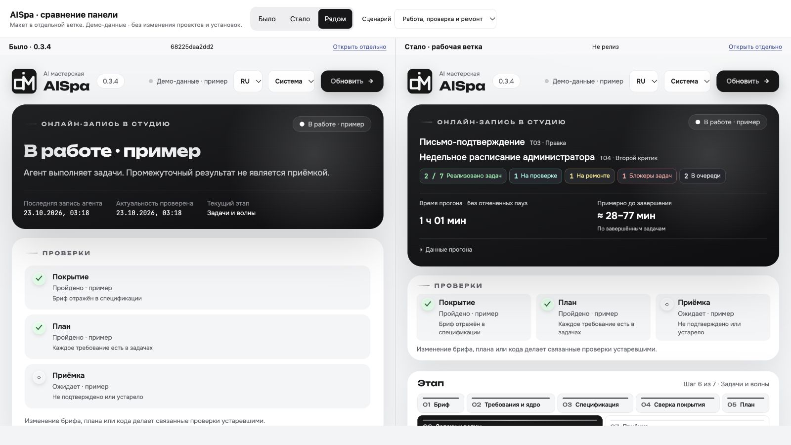

# Компактный дашборд — предложение в отдельной ветке

Поручение владельца: подготовить сравнение «было / стало» в отдельной ветке.
Релиз и слияние в main запрещены. Версия остаётся 0.3.4; установленные навыки,
закреплённые движки и viewer действующих проектов не меняются.

База сравнения: `68225daa2dd2a0619562d0bf874da49f0c3060bf`.
Ветка: `work/dashboard-compact`.

## Цель и границы

- В начале видно, что выполняется, сколько реализовано и сколько примерно осталось.
- Закрытые задачи компактны; фазы, проверки, назначения и критерии доступны
  через раскрытие. Детали не теряются ради компактности.
- Цвет вместе с текстом различает реализацию, проверку, ремонт, препятствие
  и завершение; фирменный графит и логотип мастерской сохраняются.
- Реализация отделена от актуальности доказательств. Offline, stale, пауза
  и архив не превращаются в живое подтверждение готовности.
- Обновление данных, RU/EN, светлая/тёмная темы и мобильная раскладка сохраняются.

Меняется presentation в `skills/aispa/assets/dashboard.html`. API, журнал,
движок приёмки, расчёт ETA и формат опубликованного пакета не меняются.
Используется собственная реализация; исходники референса не включаются.

## Посмотреть было / стало

Из рабочей ветки:

```text
python3 -B tools/preview_dashboard_compare.py --before 68225daa2dd2a0619562d0bf874da49f0c3060bf
```

Команда выводит локальный URL. Переключатели: «Было», «Стало», «Рядом»;
один селектор задаёт одинаковый демонстрационный сценарий обоим экранам.
База читается из точного Git commit, кандидат — из рабочего файла ветки.
Просмотр не запускает проект AISpa и не читает данные действующих прогонов.
Остановить сервер можно Ctrl+C. На Windows — `python -X utf8 -B` вместо `python3 -B`.

## Проверки

Локально: 82 Node-теста и 3 Python-проверки PASS. Нативный браузер:
1600×900 и фактический CSS viewport 390×844, раскрытие задачи,
светлая/тёмная тема, RU/EN, пауза/устаревшие проверки/принятый пример.
Горизонтальный scrollWidth совпал с clientWidth в обеих измеренных ширинах.

На одном демонстрационном сценарии при 1600×900:

| Метрика | Было | Стало |
|---|---:|---:|
| Верх первой задачи | 1232 px | 834 px |
| Высота закрытой первой задачи | 238 px | 64 px |

Это измерение конкретного макета, не гарантия для любого длинного названия
или числа задач. Снимки и DOM-измерения привязаны к SHA HTML в
[квитанции](previews/dashboard-compact/verification.json).

[Было](previews/dashboard-compact/before-desktop-final.jpg) ·
[Стало](previews/dashboard-compact/after-desktop-final.jpg) ·
[Телефон](previews/dashboard-compact/after-mobile-final.jpg) ·
[Раскрытая задача](previews/dashboard-compact/after-mobile-expanded-final.jpg).

Независимый review: технические и визуальные замечания исправлены и
перепроверены. Последнее замечание к свежести Python-квитанции закрыто
финальным адресным запуском после правок; [вердикты](previews/dashboard-compact/review.json).
[Финальный CI](https://github.com/alexfisenkov/aispa/actions/runs/39839191200)
прошёл: шесть jobs — macOS/Linux/Windows × Python 3.11/3.13.
Точный проверенный commit: `48082c663f52ecb899759bb653ef12499d6ec107`.
Последующая запись результатов меняет только документацию и снимки.
[Черновик PR №9](https://github.com/alexfisenkov/aispa/pull/9) оставлен открытым;
владелец дизайн ещё не утвердил.


Команды: `node --test tests/dashboard.test.cjs` и
`PYTHONPATH=tests python3 -B -m unittest test_dashboard_compare test_label_release_compat -v`.
Финальный адресный CI scope — `dashboard-preview`; полных модельных прогонов нет.

Следующий шаг после технической проверки — просмотр владельцем и его решение
о дизайне. Наличие ветки или зелёных тестов не разрешает слияние и выпуск.
